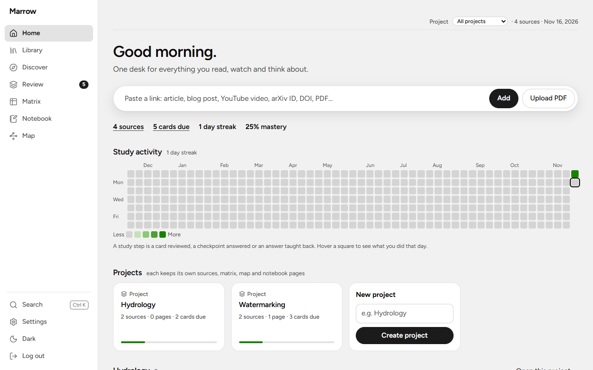
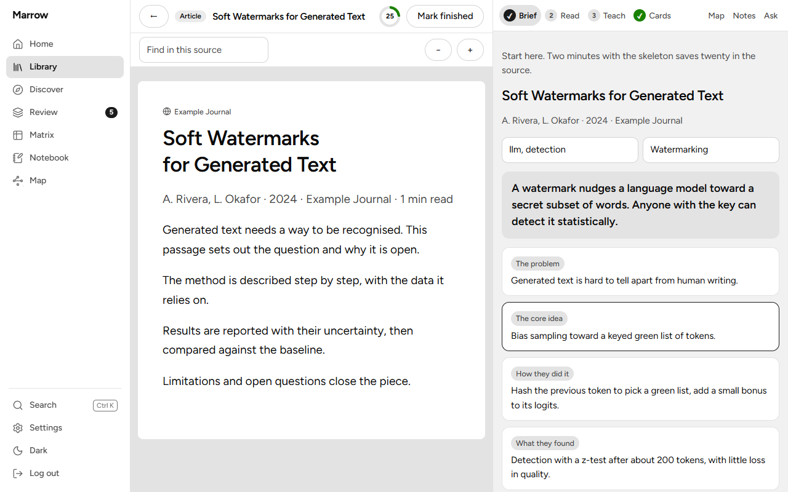
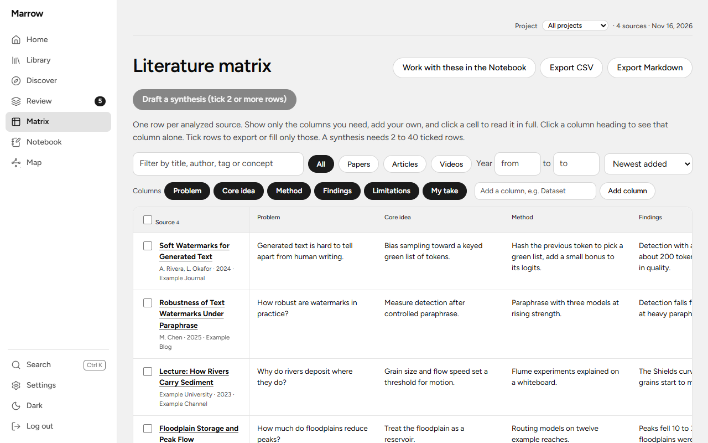
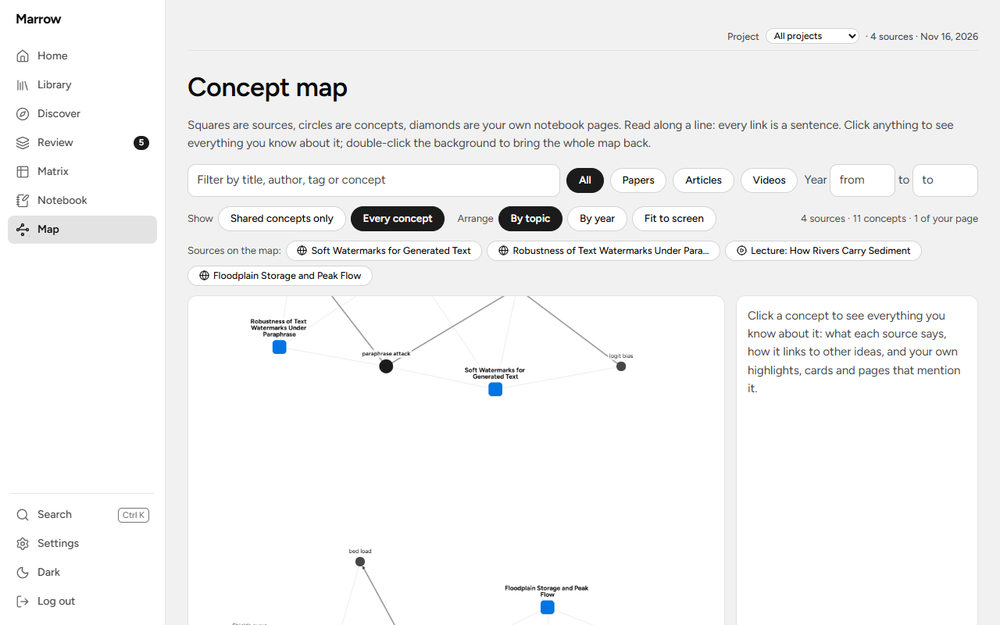
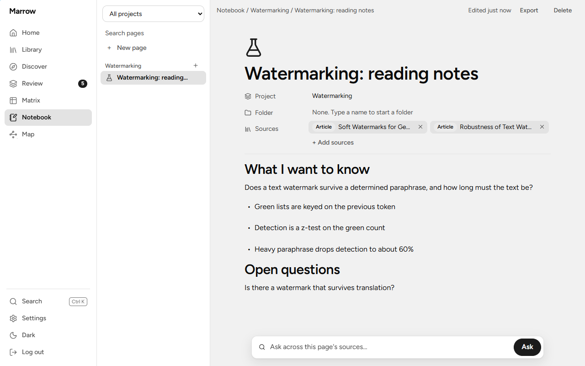

# Marrow

A research desk for one. Marrow keeps everything you read, watch and think about for your research in one place, and it makes you understand the material instead of handing you a summary.











## What goes in

Paste a link into one box, or drop a PDF anywhere:

- Papers: a PDF, an arXiv ID or link, a DOI, or any PDF URL.
- Articles and blog posts: any web page, cleaned into a reader view without ads or navigation.
- Videos: a YouTube link. The video plays next to its transcript; Marrow fetches YouTube's own captions when the video has them, or writes the transcript with Whisper on this computer, and every note, card and AI answer links to its moment in the video. Pasting a transcript (YouTube's "Show transcript" panel, SRT or VTT) still works too.
- Discover: search 250M scholarly works (OpenAlex) and add open-access papers with one click. Follow blogs, journals and arXiv categories by their address (RSS/Atom, found automatically from a blog's home page); new posts are listed there, one click from your library.

## What you do with it

Every source, whatever its kind, gets the same four steps:

1. Brief: the skeleton first, covering problem, core idea, method, results, weaknesses, prerequisites.
2. Read / Watch: section by section; each has a checkpoint question you answer from memory, graded against the source.
3. Teach: explain it in your own words; the AI finds gaps and misconceptions.
4. Keep: spaced-repetition flashcards and a concept map.

Around that:

- Projects: a project (say "Watermarking" and "Hydrology") keeps its own sources, matrix, map, review queue and notebook pages. Create one on Home, switch with the selector at the top of every page, and move sources in by ticking them in the Library. Home lists every source under the project it belongs to. Rename or delete a project from "Project settings" at the foot of its Home page; deleting keeps its sources and pages, unfiled.
- Library: tags, filters, and full-text search across every word of every source.
- Review: due cards from the whole library, stacked like a deck. Grading puts a card back where it fits: Again after the next card, Hard 3 down, Good in the middle, Easy at the bottom. Decks shows one folder per source to read, add, delete or AI-generate cards, or study just that deck. A streak and an activity grid sit underneath.
- Matrix: a literature-review table, one row per source. Filter by text, kind, project and year; show only the columns you need (click a heading to see one column alone); click a cell to pop it out for reading (arrow keys move between cells); add your own columns and have the AI fill them from each source's text, with a link to the passage it used. A fill covers only the rows on screen, asks first when there are many, can be stopped, and can be run for one cell. Exports what is on screen as CSV or Markdown, and drafts a synthesis.
- Notebook: pages of blocks (headings, lists, checklists, toggles, callouts, tables, quotes, code, math; press `/`, type `# ` for a heading, `- ` for a list, or `---` for a divider, drag a block by its handle, `@` cites a source), each with an icon, an outline of its headings and its project. A page carries the sources you are working with: tick sources in the Library and choose "Work with these in the Notebook", then ask across them. The answer is written into the page with citations that open the cited passage. Your highlights and a comparison table can be inserted the same way.
- Map: one concept map linking everything you've studied. The same filters as the Matrix, a "shared concepts only" view for large libraries, a layout by year, and a panel that says what each concept means and which sources use it. Dotted lines join concepts that mean similar things (across sources too, with an embedding model set), and a dashed ring marks concepts you haven't highlighted, carded or written about yet.
- Search: `Ctrl K` (or `/`) opens one box that finds any source, note or page, searches the full text, or adds a pasted link. In Review, `Space` shows the answer, `1` to `4` grade it (Again, Hard, Good, Easy), and `?` lists the shortcuts.
- Highlights and notes on PDFs, articles and transcripts; snip a figure or equation to have it explained; chat with citations; BibTeX; Markdown export with `[[wikilinks]]`; light and dark themes.

AI-generated flashcards and feedback must quote the source; quotes are checked against its text and anything unverified is flagged.

## Run

Requires Node 22.13+. Marrow has no dependencies to install and needs no external service: your library, notes and PDFs live in one folder on this computer.

1. Copy `.env.example` to `.env` and fill in `APP_SECRET` (64 hex characters; the command to make one is in the file). Keep a copy: it encrypts your AI keys, and if it is lost you have to enter them again.
2. Start the app. There is no sign-in screen: this is a single-user, local-only server.
3. The first time, Marrow asks where to keep your library. It suggests `Documents/Marrow` (or your existing `./data`, if you used Marrow before). You can move it later in **Settings > Library folder**. The folder holds:
   - `marrow.db`, the library itself (SQLite; `schema.sql` is the schema of record, created on first run);
   - a folder per project, with its PDFs in `papers/`, one Markdown file per source in `sources/` and your notebook pages in `pages/` (`Unfiled/` for the rest). The Markdown files are readable copies that Marrow rewrites on every change; open them in Obsidian or any editor, but make changes in Marrow;
   - a `README.md` that explains all this.

   Setting `DATA_DIR` in `.env` fixes the folder instead (useful on a server), and Settings then shows it read-only.

```bash
npm start        # node --env-file=.env server.js
```

Open http://localhost:5173, then open **Settings** (the gear, bottom left) and add the AI services you have a key for: [OpenRouter](https://openrouter.ai), OpenAI, Claude, Gemini, a local Ollama, or anything else that speaks the OpenAI chat format. Each provider has its own address and key. "Save & test" checks the key and loads what the provider offers; then search that list (or type a name) to add a model. Drag the models into the order Marrow should try them: when one fails or is rate limited, the next one answers, and a model can come from any provider. Each model is switched on for Text, Images (explaining figures, so it must read images), or both. While the AI works, a box at the bottom right shows the time so far and which model is answering, and any model that failed is named with its reason. "Test the connection" tells you which model answered. The keys are yours; the server has none of its own. Keys are encrypted with `APP_SECRET` before they are stored in the database, are never sent to the browser (Settings shows only the last four characters), and can be replaced or removed from the same screen. On OpenRouter, free models are always asked before paid ones (a test too), and paid models are marked “paid”, so add one only if you mean to pay for it. Other providers are always asked, so choose their models with care.

**Transcription.** In Settings, download the *YouTube helper* (yt-dlp) to fetch a video's existing captions with one click, or Whisper to transcribe anything: the Whisper program is fetched from whisper.cpp's GitHub releases on Windows (on a Mac run `brew install whisper-cpp` first), then pick a model and download it from Hugging Face. Videos use YouTube's captions when available and fall back to Whisper; you can also transcribe any audio or video file from a video's page. Audio is decoded in the browser, so no ffmpeg is needed, and Whisper runs on the server's computer: nothing but the video's captions or sound is fetched, and the audio goes no further than your own server. Everything is stored under `data/whisper/` and can be removed again from Settings. Whisper and the YouTube helper are shared by everything you transcribe.

**Tests.** The checks use a throwaway `DATA_DIR`, so they never touch your library.

- `npm test` runs the server check (`test.js`: saving, storage, full-text and vector search, link-fetching rules) and the frontend check (`test-frontend.js`: the script parses, every look is complete and readable).
- `npm run test:ui` opens the running app in a real browser and visits every screen in every look, light and dark. It needs `npm i --no-save playwright` first; `PW_CHANNEL=chrome` uses the Chrome you already have.
- Add `#test` to the URL to run the browser self-check (see the console).

## How it works

- `server.js`: serves the app, proxies AI calls with your keys (which never reach the browser), fetches the links you add, and fetches captions or runs Whisper for videos. It listens on this machine only. There is no login: anyone who can reach the server can read and change everything, so do not set `HOST=0.0.0.0` on an untrusted network. If you must, put it behind your own access control and set `ALLOWED_HOSTS` for a domain name.
- `local.js`: the local store — one library in `marrow.db`, with SQLite full-text search and vectors, and the library folder (PDFs and Markdown copies in a folder per project).
- `index.html`: the whole app.
- `schema.sql`: the SQLite tables: `items` (sources), `parts` (their text, full-text index and vectors), `cards`, `notes` (highlights, and notebook pages), `activity`, `feeds`, `settings`, `paths` (where each file in the library folder is), `concept_emb`.
- `data/`: Whisper's and the YouTube helper's downloads, and the library too if you keep it here. Use Backup in the Library for a single portable file of everything.

More detail is in [`docs/`](docs/): how to use each part, and how the code fits together.

**Moving from Supabase.** Start Marrow once and choose the library folder. Then put `SUPABASE_URL` and a `SUPABASE_SERVICE_ROLE_KEY` in a `.env.migrate` file, then run `npm run migrate -- you@example.com`. It copies one account's sources, text, cards, notes, activity, feeds, settings (including encrypted AI keys) and PDFs into the local store. Use the same `APP_SECRET` as before or re-enter your keys. Keep the service-role key out of `.env`; it is only for this one-time move. Old backup files still restore from the Library screen.

## Looks

Settings has a **Look** picker: Studio (the default: neutral greys, Figtree, words instead of icons in the rail), Lab notebook (the original), Concourse, Barcode, Cyanotype, Survey and Page. Each changes colour, type, edges and density; light and dark work in every one. The choice is remembered in the browser. Adding `?look=survey&theme=dark` to the address previews one without saving it.

**Add your own.** At the end of the stylesheet in `index.html` (between the `LOOKS-BEGIN` and `LOOKS-END` markers):

1. Add a block for light and one for dark. Dark must restate every colour, because the light colours would otherwise win:

   ```css
   [data-look=mine]{--bg:#fff;--panel:#fff;--ink:#111;--muted:#555;--line:#ddd;--acc:#0b6bcb;--acc-bg:#e7f0fb;--ok:#1d7a3f;
     --pdf:#eee;--web:#0b6bcb;--vid:#b3261e;--sh:none;--pop:0 6px 18px #0002;--pri:#0b6bcb;--pri-h:#0958a8;--on-pri:#fff;
     --on-n:#fff;--scrim:#0008;--logo-a:#0b6bcb;--logo-b:#084a8c;--sig:#0b6bcb;
     --h0:#e3e3e3;--h1:#c6e6c6;--h2:#8fd19e;--h3:#4eae6b;--h4:#2a7f48; /* the five activity levels */
     --f-body:system-ui,sans-serif;--f-display:system-ui,sans-serif;--f-mono:ui-monospace,monospace;--r:4px;--r2:6px}
   [data-look=mine][data-theme=dark]{ /* the same colour tokens again, for dark */ }
   ```

2. Add `['mine', 'My look', 'One line about it.']` to the `LOOKS` list in the script, so it shows in the picker.
3. If you use a web font, add it to the Google Fonts link in the head. System fonts need nothing.
4. Anything beyond colours and type (shapes, spacing, a signature touch) goes in rules that start with `html[data-look=mine]`.

You do not touch the tests: both checks find looks on their own. `node test-frontend.js` tells you exactly what is missing (a token, a dark block, a font, a picker entry, text under 4.5:1 contrast), and the browser test then checks the look as it renders on every screen.

## Checks on every push

`.github/workflows/ci.yml` runs the server check on Node 22 and 24, the frontend check, and the browser test, on every push and pull request. No external service is needed; the only secret is `APP_SECRET` (any 64 hex characters), set under GitHub > Settings > Secrets and variables > Actions. A final job called **CI passed** is green only when all three are. To make it required: GitHub > Settings > Branches > add a rule for `main` > *Require status checks to pass before merging* > select **CI passed**.
